# 🏄 Scott Lozano

  

  
  
  

---

### 🌟 About Me
I am an experienced **Full-Stack Software Engineer** specializing in full-stack development, scalable backend microservices, and decentralized web technologies. Known for constant building and rapid adaptation, I craft high-performance solutions across web, backend, security, and Web3 environments.

---

### 💼 Who I've Coded Software With

I have collaborated with world-class engineering teams to build robust web systems, scale backend architectures, and implement modern features.

  
  &nbsp;&nbsp;&nbsp;&nbsp;&nbsp;&nbsp;
  
  &nbsp;&nbsp;&nbsp;&nbsp;&nbsp;&nbsp;
  

- 🛌 **Emma Sleep** (Global Sleep-Tech E-Commerce Giant)
  - Contributed to backend optimization and scalable architectures for a leading global sleep-tech e-commerce platform.
  - Worked on high-performance **GoLang** microservices to support complex high-traffic transactional workflows.
- 🪙 **Exodus Movement** (Premier Crypto & Web3 Ecosystem)
  - Implemented secure wallet-focused enhancements and frontend interface workflows.
  - Utilized cutting-edge JavaScript, TypeScript, and decentralized protocols for safe, performant transactions.
- 🎨 **Artsvp** (Comprehensive Ticketing & Booking SaaS)
  - Designed core features for an elegant registration and booking SaaS platform trusted by galleries and art fairs globally.
  - Streamlined public-facing checkouts, ticket generation pipelines, and organizer admin tools.

---

### 🚀 Featured Achievements & Projects

- 🛠️ **GoLang Microservices**: Engineered performant microservices to support millions of e-commerce checkout operations at a global scale.
- ⛓️ **Polygon Web3 DApp**: Designed and deployed a complete, end-to-end full-stack decentralized application (DApp) on the Polygon network.
- 🦊 **Zendesk Web3 Support Clone**: Developed a Ruby on Rails customer support SaaS featuring built-in block explorer integrations, cryptocurrency wallet APIs, and asset validation workflows.
- 🎭 **Art Ticketing SaaS**: Architected major workflows for a robust scheduling, reservation, and ticketing platform handling custom guest limits and transactional emails.
- 🤖 **Workflow Automation Extensions**: Programmed 4 specialized Chrome browser extensions leveraging **Puppeteer** and **Node.js** to automate complex pipelines and scrape insights safely.

---

### 🛠️ Languages and Tools

| Category | Technologies |
| :--- | :--- |
| **Languages** |        |
| **Frameworks & Libs** |          |
| **Databases** |    |
| **DevOps & Tooling** |       |
| **Automation & Testing** |     |
| **Design** |  |

---

### 📊 GitHub Stats & Metrics

  
  
  

  

  
  

> [!NOTE]
> I am mostly focused on **Ruby** and **TypeScript** these days. The languages breakdown above only details code pushed to public repositories on GitHub and is not fully representative of my broad scope of experience (such as custom backend microservices and proprietary applications).

  

  

